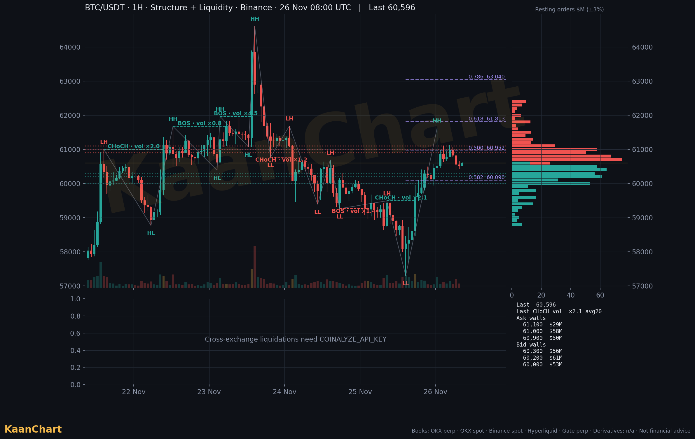

  

## 👋 أهلًا، أنا KaanChart

أحلّل سوق العملات الرقمية بالبيانات: الشارت، والهيكل السعري، والعقود الآجلة، وخرائط التصفيات.

### 📊 وش تلقى عندي
- **تحليل البيتكوين** على فريم الساعة واليومي
- **الهيكل السعري**: القمم والقيعان، BOS وCHoCH
- **العقود الآجلة**: العقود المفتوحة، والتمويل، ونسبة Long/Short
- **خرائط التصفيات** ومناطق السيولة
- **أخبار السوق** وتأثيرها، بدون تهويل

### 🧭 مؤشرات KaanChart

<!-- KAANCHART:START -->

**آخر تحديث:** 2026-11-26 08:00 UTC · **السعر:** 60,596

| المؤشر | الحالة | التفاصيل |
|---|---|---|
| الهيكل | صاعد | آخر إشارة CHoCH صاعد عند 59,490 |
| Long/Short (OKX) | متوازن | 2.47 |
| جدران الأوامر | شراء أثقل | شراء 60,200 (61M$) · بيع 61,000 (58M$) |

**المستويات:** إغلاق ساعة فوق 61,622 يكسر آخر قمة · إغلاق ساعة تحت 57,300 يكسر آخر قاع

> قراءة آلية للمؤشرات، وليست توصية مالية.

<!-- KAANCHART:END -->

### 📈 آخر شارت

يتحدّث تلقائيًا كل يوم بعد إغلاق الشمعة اليومية (00:07 UTC).

### 📬 تابعني
- تيليجرام: [t.me/kaanchart](https://t.me/kaanchart)
- إكس: [@kaanchart](https://x.com/kaanchart)

> ⚠️ كل المحتوى للتعليم فقط، وليس توصية مالية.

